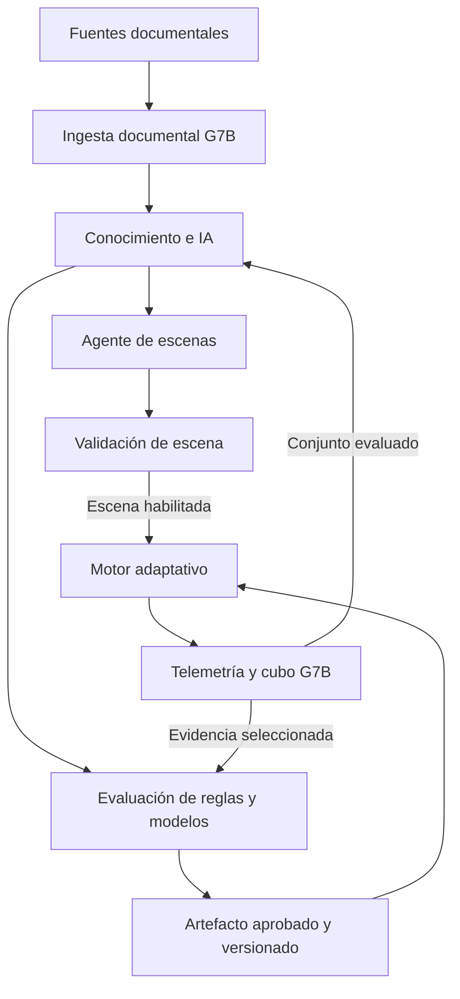

# Geoda: conocimiento para IA y motor adaptativo

Fecha: 2026-11-17.
Estado: decisión de arquitectura acordada; implementación progresiva.
Esta entrega documenta responsabilidades y criterios de aceptación. No activa
entrenamiento, agentes, nuevos servicios ni control automático de Blender.

## 1. Decisión

Geoda se desarrollará en dos líneas independientes:

1. **Conocimiento e IA:** preparar información trazable para consulta, evaluación
   y, cuando corresponda, entrenamiento de modelos.
2. **Motor adaptativo:** observar una sesión 3D, decidir ajustes permitidos,
   aplicarlos, medir sus efectos y revertirlos si no ayudan.

Amatista integra las capacidades según la tarea educativa. G7B aporta la ingesta,
preparación y publicación de datos. La generación de escenas será una aplicación
consumidora del conocimiento y de modelos, con ejecutor y validación propios.

Aquí «kernel» significa núcleo de decisiones de aplicación; no un sistema
operativo ni un reemplazo del motor de render de Blender.

La visión incluye una API pública con contratos separados. Este documento no
afirma que esas interfaces estén implementadas ni obliga a crear repositorios,
servidores o servicios nuevos. Inicialmente basta separar módulos y contratos.

## 2. Responsabilidades

| Área | Recibe | Hace | Entrega | No le corresponde |
|---|---|---|---|---|
| G7B: ingesta documental | Manuales, documentación, foros y ejemplos autorizados | Captura, procedencia, depuración, versiones y controles de calidad | Documentos y conjuntos documentales versionados | Aplicar ajustes en Blender |
| Conocimiento e IA | Documentos preparados y evidencias seleccionadas | Recuperación de información, preparación de ejemplos, evaluación y entrenamiento si se justifica | Biblioteca consultable, conjuntos de datos y modelos evaluados | Controlar directamente la sesión del usuario |
| G7B: telemetría y cubo | Mediciones y experimentos reales identificados | Validación, unidades, deduplicación, trazabilidad y análisis | Evidencia numérica comparable | Convertir opiniones en mediciones |
| Motor adaptativo | Estado de escena, recursos observables, tarea y reglas o modelos aprobados | Diagnóstico, planificación, aplicación reversible y verificación | Ajustes y registro de sus resultados | Rastrear páginas o entrenar modelos durante la interacción |
| Agente generador de escenas | Intención del usuario, conocimiento pertinente y herramientas autorizadas | Proponer y ejecutar una construcción controlada; validar el resultado | Escena candidata y reporte de validación | Certificar rendimiento por haber generado código |
| Amatista | Resultados de las líneas anteriores | Definir objetivo educativo, interfaz, límites de cambios y consentimiento | Experiencia educativa y resultados de la práctica | Suponer que cualquier mejora de FPS mejora el aprendizaje |

Documentos, mediciones, modelos y escenas generadas son artefactos distintos.
No deben compartir una tabla de hechos ni una etiqueta genérica de «evidencia».

## 3. Flujos independientes

El motor también debe poder trabajar sobre escenas creadas manualmente.
La ausencia del agente generador, del buscador documental o de internet no debe
impedir su funcionamiento básico con reglas locales y versión estable conocida.

La ingesta documental puede avanzar sin ejecutar Blender; la adaptación puede
avanzar sin entrenar un modelo generativo. Las dos líneas tienen pruebas y
versiones independientes. Trabajar separadamente no exige hacerlo todo a la vez.

## 4. Contratos de intercambio propuestos

Son requisitos de diseño; no son nuevos esquemas ya implementados ni sustituyen
los contratos vigentes sin una migración explícita.

| Artefacto | Información mínima |
|---|---|
| Documento preparado | ID y versión, fuente y URL, tipo de fuente, programa y versión aplicable, fecha de captura, hash, licencia y usos admitidos, contenido o referencia |
| Conjunto para IA | ID y versión, tarea objetivo, documentos o ejemplos incluidos, transformaciones, procedencia, restricciones, separación de entrenamiento y evaluación |
| Regla o modelo candidato | ID y versión, tarea, compatibilidad, entradas y salidas, límites, evidencia de evaluación y estado de aprobación |
| Paquete para el motor | Reglas o modelo aprobado, versión de contrato, integridad, condiciones de aplicación, límites de recursos y alternativa local |
| Experimento adaptativo | ID de sesión/corrida y observación, versiones de motor y aplicación, contexto técnico permitido, objetivo, acción, estado previo, medidas antes/después, calidad, resultado y reversión |
| Escena generada | ID y versión, intención, procedencia de recursos, versión del generador, validación funcional y restricciones de uso |

Las claves de corrida, observación y contenido tienen funciones distintas.
No identificar observaciones por su posición en una lista; conservar equivalencias
auditables cuando se migren IDs antiguos. No confundir una configuración declarada
con un equipo físico único.

La telemetría compartida conserva las restricciones de privacidad del proyecto.
El registro local necesario para deshacer no implica subir archivos, contenido de
escenas, rutas personales o estados completos al lago.

## 5. Alimentación de IA

El primer resultado útil será conocimiento consultable y evaluable. Recuperar
documentos para que un modelo los consulte no modifica por sí mismo su entrenamiento.

Entrenar o ajustar un modelo es una etapa distinta: exige tarea definida, ejemplos
adecuados, separación de evaluación y medición de resultados. Los conjuntos se
versionan y se controlan duplicados para evitar evaluar con ejemplos del entrenamiento.

Manuales, respuestas de foros, hipótesis y mediciones mantienen categorías
separadas. Se conserva autoría y procedencia; una respuesta popular no se declara
verdadera automáticamente. El permiso para consultar una fuente no se interpreta
automáticamente como permiso para redistribuirla o entrenar con ella.

Una afirmación documental puede proponer una regla candidata. Debe pasar por
validación y evaluación antes de convertirse en una acción automática.
Texto recuperado y código generado no se ejecutan directamente en el motor.

## 6. Acoplamiento del motor adaptativo

Bucle previsto: observar → diagnosticar → decidir → aplicar → medir → conservar o revertir.

- Empezar con un catálogo pequeño de acciones reversibles y reglas comprobables.
- Respetar lo que debe conservarse para la tarea: geometría, apariencia, controles
  y objetivos educativos. Un aumento de FPS no basta para aceptar un cambio.
- Registrar valores anteriores; no sobrescribir cambios posteriores del usuario
  durante una reversión.
- Definir frecuencia de observación, presupuesto de cómputo y pausa entre ajustes
  para que el propio motor no degrade la experiencia ni oscile entre estados.
- Diferenciar ajustes de previsualización de cambios en la salida final.
- Tener una alternativa local cuando falten datos, el modelo no sea compatible
  o no exista conexión. No exigir un modelo generativo en el ciclo de control.
- Implementar adaptadores separados para Blender y A-Frame, con capacidades y
  versiones explícitas. Una métrica de un programa no se transfiere al otro sin validar.

Puede incorporar modelos predictivos pequeños tras evaluarlos. Eso no convierte
al motor en responsable del entrenamiento: consume un artefacto aprobado.

## 7. Criterios de aceptación por línea

| Línea | Primera entrega verificable | Evaluación |
|---|---|---|
| Conocimiento e IA | Un conjunto acotado y versionado que responde preguntas técnicas con procedencia | Comparar respuestas con y sin recuperación, pertinencia, exactitud de versión, citas y abstención cuando falte evidencia |
| Motor adaptativo | Una escena, una tarea y un ajuste reversible probado en un entorno declarado | Comparar con configuración fija: fluidez, memoria cuando sea medible, costo del motor, calidad conservada y reversión |
| Agente generador, posterior | Una práctica generada que abre y cumple requisitos definidos | Validez de escena, cumplimiento de tarea y ejecución controlada; medir rendimiento por separado |
| Intercambio | Un artefacto aprobado consumido por el motor y un experimento registrado | Compatibilidad, integridad, trazabilidad y alternativa ante fallo |

Los umbrales y equipos de evaluación se fijan antes del experimento. Registrar
resultados negativos y casos sin datos. Publicar una recomendación exige evidencia;
la existencia del cubo o de documentación no la habilita por sí sola.

Una escena de origen generado y una medición inventada no son lo mismo:
si se mide realmente una escena generada en un equipo, declarar ambas procedencias
y mantener ese conjunto experimental separado hasta definir su admisión.
Este documento no cambia el validador vigente ni autoriza mezclar simulaciones
con observaciones reales.

## 8. Orden de implementación

1. Mapear componentes actuales a estas responsabilidades sin moverlos por estética.
2. Definir y probar por separado contratos documentales y de experimentos.
3. Entregar la primera evaluación de conocimiento y la primera prueba adaptativa
   como hitos independientes, con presupuesto y alcance propios.
4. Habilitar el intercambio de artefactos solo después de validar ambas interfaces.
5. Añadir el agente generador como consumidor, cuando tenga ejecutor y pruebas.
6. Ampliar la API y aplicaciones según resultados, no por volumen almacenado.

El alcance inicial es Blender y A-Frame con herramientas abiertas.
Una futura integración con software o contenido bajo otras licencias se evaluará
como adaptación separada; no se cambia hoy la licencia del repositorio.

## 9. Relación con la documentación existente

Esta decisión actualiza la separación de responsabilidades del
[plan maestro](PLAN_MAESTRO.md). El resto de sus reglas operativas se conserva.
[GEODA.md](GEODA.md) describe los cimientos históricos; sus capacidades no prueban
que todo este diseño esté implementado.

Consultar también [ingesta](INGESTA.md), [telemetría](TELEMETRIA.md),
[cubo](CUBO.md) y la [investigación sobre el modelo analítico](investigacion/2026-11-17_cubo_documentacion_oficial.md).
La separación aquí acordada es una decisión del proyecto, no una norma atribuida
a un fabricante.
